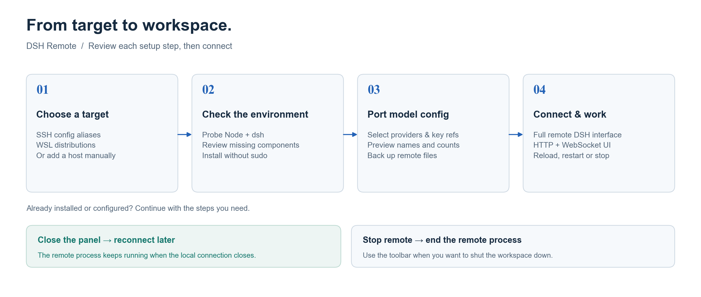
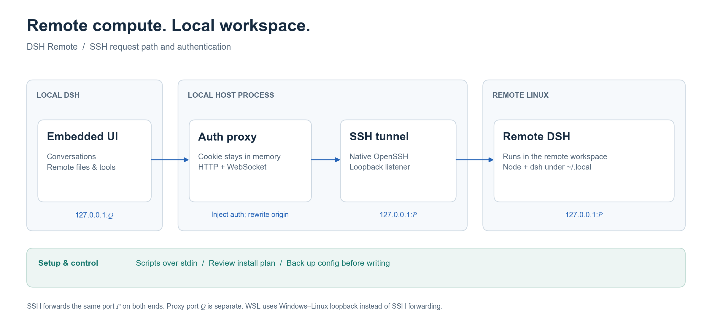

# dsh-remote · Remote Workspace

**Keep the interface local. Run the work remotely.**

Connect an SSH server or WSL distribution to [DeepSeek Harness](https://github.com/deepseek-ai/deepseek-harness). Pick a target in the sidebar and use its full DSH interface in your local window. Conversations, commands and file operations run on the remote instance.

[中文](README.md) · [Install](#install) · [Workflow](#workflow) · [Architecture](#architecture) · [Report an issue](https://github.com/Lee-Eee-Eee/dsh-remote/issues)

[](https://github.com/Lee-Eee-Eee/dsh-remote/actions/workflows/ci.yml)


[](LICENSE)


*Real desktop screenshot. Private host and conversation details were masked by the screenshot provider.*

## What it handles

| Your workflow | What dsh-remote provides |
|---|---|
| Work on a Linux server | Discover SSH aliases and reuse local keys, ssh-agent and jump-host settings |
| Open a WSL project | Discover distributions alongside SSH targets |
| Prepare a new environment | Review the installation plan, then install Node and dsh under the remote user's home without sudo |
| Use your existing models | Select providers, default model and key references to port; back up remote files before writing |
| Stay in one window | Embedded remote UI with reload, fullscreen, restart and stop controls |
| Return after disconnecting | Recover a running remote instance; retry dropped SSH tunnels automatically |

Plain ESM. **No build step. No runtime npm dependencies.**

## Install

Add this GitHub source in DSH's plugin manager:

```text
github:Lee-Eee-Eee/dsh-remote#v0.1.2
```

Or use the CLI with the profile your host actually runs. This example uses `desktop`; replace it with `web` for a web host:

```powershell
dsh plugin --profile desktop add "github:Lee-Eee-Eee/dsh-remote#v0.1.2"
```

Restart DSH and refresh the page. **Remote** appears in the sidebar. This plugin is available from GitHub; it has not been published to npm.

<details>
<summary>Install from a local checkout / develop</summary>

```powershell
git clone https://github.com/Lee-Eee-Eee/dsh-remote.git
Set-Location dsh-remote
dsh plugin --profile desktop add "$($PWD.Path)"
```

The checkout itself is the bundle; the plugin manager can also install that directory. Restart DSH after host-side edits, and refresh the page after edits to `client.js`.

</details>

**Requirements:** local DSH ≥ `0.2.1-rc.2`, Node `^22.19.0 || >=24`; Linux x86_64 / arm64 targets with `bash`, `tar`, and `curl` or `wget`. SSH targets need key or agent authentication. WSL needs Windows–Linux loopback reachability.

## Workflow



1. Open **Remote**. The panel discovers `~/.ssh/config` aliases, including `Include` files, and WSL distributions. Wildcard host patterns are skipped.
2. Add a discovered target with **+**, or enter a host manually.
3. **Probe** shows OS, architecture, Node, dsh, tmux, disk space and the SSH host fingerprint. Results are cached for ten minutes.
4. If something is missing, **Review install plan** shows commands, destinations, download sources and estimated sizes. Confirm the steps to install; logs stream into the panel.
5. **Port local config** lets you select model configuration to copy to the remote profile.
6. **Connect** opens the full remote DSH interface. Use the toolbar to reload, open in a browser, copy its local address, go fullscreen or restart.
7. **Stop remote** ends the remote process. Closing the panel or restarting local DSH leaves it available for reconnection. Use existing installations and configuration directly when they are already ready.

## Architecture



The proxy has its own port `Q`. The SSH tunnel uses the same port `P` on both ends so the remote request authority matches the authority bound into the DSH authentication cookie. WSL uses its existing loopback path instead of an SSH tunnel.

- **Native OpenSSH.** Probe, launch and forwarding use the local `ssh` executable, preserving config aliases, keys, ssh-agent, ProxyJump and ProxyCommand.
- **Scripts over stdin.** `ssh host bash` and `wsl.exe … -- bash` receive scripts on stdin. Passing scripts through `bash -c` would expose quotes and `$(...)` to Windows command-line re-parsing.
- **Host-owned authentication.** The desktop's custom `app` origin makes an HTTP iframe cross-site; a `SameSite=Strict` remote cookie would be blocked. The host performs the token handshake, holds the cookie in memory and injects it upstream. The iframe URL contains no token, and upstream `Set-Cookie` headers stay out of browser responses.
- **API and WebSocket forwarding.** The proxy rewrites Host, Origin and Referer to the upstream authority and sets Sec-Fetch-Site to same-origin so the remote request fence accepts embedded traffic.
- **End-to-end startup check.** An anonymous GET `/` through the proxy must return 200 before the state becomes running. The live embed test also verifies the real UI, WebSocket 101 with cross-site markers, data received, and API POST passing the fence.
- **Lifecycle management.** tmux is optional. A fallback runner writes its own PID before `exec` so it tracks dsh rather than a short-lived setsid parent. Launch reaps the previous instance using that target's old log port. Reconnection can reuse a still-running instance.
- **SSH host keys.** `accept-new` records a first connection and rejects changed keys. Verify a changed fingerprint with the host administrator before removing the old known-host record.

## Configuration porting

The selection reads the current local profile and writes to the remote web profile:

| Item | Handling |
|---|---|
| `llm-pi-ai` providers | Replace selected provider blocks, including model lists and base URLs |
| `agent-default-model` | Copy the default model block |
| Credential `refs` | Merge selected API-key references into remote `.credentials.yaml` |
| DeepSeek account credentials | Optional, off by default; enable only for a trusted target |

Previews show names and counts. Secret values are never returned in the preview; token-bearing errors are redacted. Browser-session records are excluded. Each remote file is backed up to `*.bak-<timestamp>` before writing. The patch editor handles a fresh profile's `[]` placeholder and preserves unrelated blocks.

## Files and lifecycle

| Location | Content |
|---|---|
| Local `~/.dsh/dsh-remote.json` | Saved targets, written with mode 0600; runtime token, ports and tunnels stay in memory |
| Remote `~/.dsh-remote/<id>.log` | Per-target dsh output |
| Remote `~/.local/node-<version>` and `~/.local/bin/dsh` | User-local Node and dsh installations |
| Remote `~/.dsh/profiles/web/cordis.patch.yml` | Ported provider and default-model blocks |
| Remote `~/.dsh/.credentials.yaml` | Merged credential references, mode 0600 |

After 30 minutes without panel access, idle cleanup releases the local connection while leaving remote dsh running. Explicit **Stop remote** shuts it down.

## Limitations and troubleshooting

- Remote conversations and projects stay inside the embedded remote interface. Projecting them into local session rows requires a separate ACP integration.
- SSH password prompts and interactive first-connection fingerprint approval are unsupported. Confirm key/agent login from your terminal first.
- WSL needs mirrored networking or NAT with `localhostForwarding=true`. If you change `.wslconfig`, apply it with `wsl --shutdown` when your WSL work is saved.

| Symptom | Check |
|---|---|
| SSH authentication fails | Verify `ssh <alias>` works without a password prompt |
| Host-key verification fails | Verify the new fingerprint before using `ssh-keygen -R <host>` and reconnecting |
| Tunnel does not start | Check SSH forwarding is permitted by the server |
| Blank remote UI | Reload, then inspect the target's `~/.dsh-remote/<id>.log` |
| UI opens but model calls fail | Port provider configuration and key references, then restart remote dsh |
| Embedded page shows an authentication error | Restart local DSH to ensure the host proxy code is loaded |

## Tests

```powershell
npm test                     # YAML editing, routes, loopback fence, CRUD, redaction
node tests/embed-auth.mjs     # real anonymous UI, cross-site WebSocket 101, API POST
node tests/http-live.mjs      # probe → config → start → anonymous iframe 200 → stop
node tests/e2e-wsl.mjs        # probe + install plan on Debian WSL
node tests/cycle-wsl.mjs      # start → stop → start, then clean up
```

Live tests use temporary registries and a real WSL target. The HTTP test writes selected model configuration with backups. `e2e-wsl.mjs --install --start` also installs and launches the remote runtime. CI runs syntax checks and the two host-independent suites.

Validated on Debian 12 (WSL2), Node v22.23.4 and dsh 0.2.1-rc.5: config porting, anonymous UI 200, cross-site WebSocket 101, API POST 200 and two start/stop rounds. The v0.1.2 archive also installed into an isolated DSH profile with its bundle, client and README images intact.

The [diagram source](docs/figures/render.py) follows [ohmyplt](https://github.com/Lee-Eee-Eee/ohmyplt) conventions: Arial labels, Times New Roman math and numerals. Python and Matplotlib are needed only to regenerate the figures. PNG, editable SVG and a source-hash manifest are in `docs/assets/`.

## Changelog

### 0.1.2 · 2026-11-01

- Add a real screenshot, setup and authentication diagrams, and version-pinned GitHub installation instructions in both languages.
- Allow public bundle index discovery, include README images in the package and declare their marketplace order in `screenshots.json`.
- Make the WSL cycle test fail with a nonzero exit and stop its second instance during cleanup.

### 0.1.1

- Rewrite Origin, Referer and Sec-Fetch-Site in the proxy so embedded API and WebSocket requests pass the remote fence.

## License

MIT — see [LICENSE](LICENSE).
