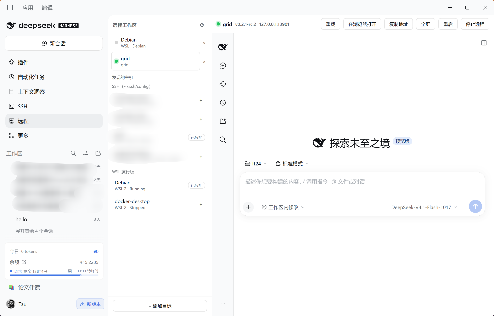

<p align="center">
  
</p>

<h1 align="center">dsh-remote</h1>

<p align="center">SSH and WSL remote workspaces inside DeepSeek Harness</p>

<p align="center">
  <a href="https://github.com/Lee-Eee-Eee/dsh-remote/releases"></a>
  <a href="https://github.com/Lee-Eee-Eee/dsh-remote/actions/workflows/ci.yml"></a>
  <a href="LICENSE"></a>
</p>

<p align="center">
  <a href="README.md">简体中文</a> / English · <a href="#install">Install</a> · <a href="#first-connection">Usage</a> · <a href="#documentation-and-feedback">Docs</a>
</p>

`dsh-remote` adds a **Remote** entry to [DeepSeek Harness](https://github.com/deepseek-ai/deepseek-harness). Connect a Linux server over SSH or a WSL distribution and open its full DSH interface in your local window. File operations and commands run in the target environment.



*Desktop screenshot.*

## Features

- **SSH and WSL targets.** Discover hosts from your SSH configuration and local WSL distributions, or add targets manually. SSH connections reuse local keys, ssh-agent and jump-host settings.
- **Remote setup.** Probe Node and DSH, review the installation plan, then install the selected components under the remote user's home without sudo.
- **Model configuration.** Copy local providers, the default model and API keys to the remote environment, with backups before writing.
- **Connection controls.** Reload, go fullscreen, restart or stop remote DSH from the panel. Reconnect to an existing instance, with automatic retries for dropped SSH tunnels.

## Install

Requires DSH `0.2.1-rc.2` or newer. Add this source in the plugin manager:

```text
github:Lee-Eee-Eee/dsh-remote#v0.1.2
```

Restart DSH and refresh the page. **Remote** appears in the sidebar.

<details>
<summary>Install from the command line</summary>

If `dsh` is available in your terminal, run:

```sh
dsh plugin --profile desktop add "github:Lee-Eee-Eee/dsh-remote#v0.1.2"
```

Replace `desktop` with the profile your host actually uses; web hosts typically use `web`. Installing into another profile will not add the plugin to the current host.

</details>

## First connection

1. **Add a target.** Open **Remote** and click **+** beside an SSH host or WSL distribution. Use **Add target** to enter an SSH alias or host details manually.
2. **Probe the environment.** Select the target and click **Probe**. If Node or DSH is missing, open **Review install plan**, choose the steps and start installation.
3. **Configure a model.** If the remote has no model configuration, open **Port local config**, select the provider, default-model and API-key groups you need, then click **Write and restart**. The API-key group copies actual secret values, so use a target you trust. Skip this step when the remote already has a working model.
4. **Connect.** Click **Connect**, then choose a remote project in the embedded DSH interface and start working.

Configuration previews show names and counts only. Remote conversations and projects are managed inside the embedded DSH interface.

### Once connected

| Action | Effect |
|---|---|
| Reload | Refresh the remote interface |
| Restart | Restart DSH on the target |
| Stop remote | End the target instance and close the local connection |
| Close the panel / exit local DSH | Leave the remote process running for reconnection |

## Requirements

| Environment | Requirement |
|---|---|
| Host runtime | Node `22.x` (≥ `22.19.0`), or `24` and newer |
| SSH target | Linux x86_64 / arm64 with non-interactive key or agent authentication |
| Automatic setup | `bash`, `tar`, and either `curl` or `wget` |
| WSL | Windows–Linux loopback reachability: mirrored networking, or NAT with localhost forwarding enabled |

## Common questions

**No Remote entry after installation?** Check that you installed into the current host's profile, then restart DSH and refresh the page.

**SSH connection fails?** Verify that `ssh <alias>` works without an interactive prompt and that the server permits SSH port forwarding. Password prompts are unsupported.

**The interface opens but the model does not work?** Check the remote model configuration. After applying **Port local config**, restart remote DSH.

For WSL networking, host-key and embedded authentication issues, see [troubleshooting](docs/architecture.en.md#troubleshooting).

## Documentation and feedback

- [Technical reference](docs/architecture.en.md): connection architecture, authentication, configuration porting, file locations and troubleshooting.
- [Contributing](CONTRIBUTING.md): local installation, validation commands and code organization.
- [Changelog](CHANGELOG.md) · [Releases](https://github.com/Lee-Eee-Eee/dsh-remote/releases)
- [Report a bug or suggest a change](https://github.com/Lee-Eee-Eee/dsh-remote/issues) with your DSH version, target type, reproduction steps and a sanitized error message.

## License

[MIT](LICENSE)
