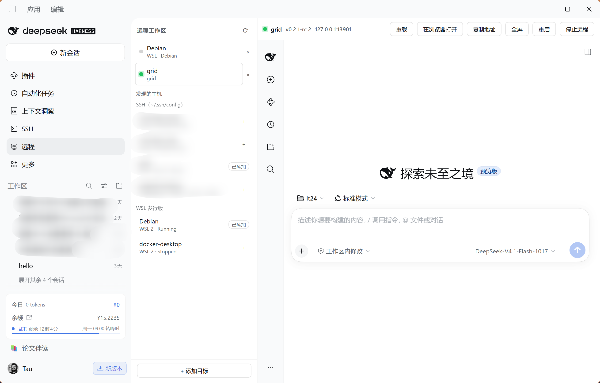
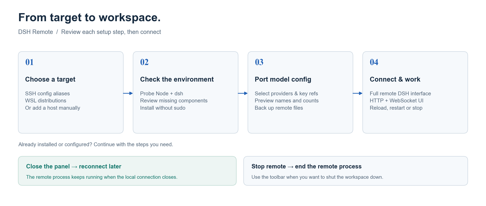
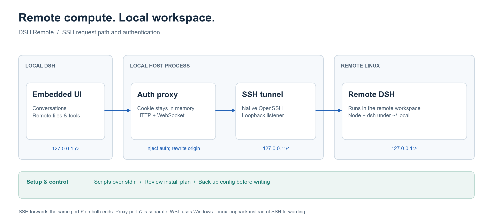

# dsh-remote · 远程工作区

**界面留在本地，工作跑在远程。**

把 SSH 服务器或 WSL 发行版接入 [DeepSeek Harness](https://github.com/deepseek-ai/deepseek-harness)：从侧栏选择目标，在本地 DSH 主区使用远程 DSH 的完整界面。对话、命令和文件操作由远程实例执行。

[English](README.en.md) · [快速安装](#安装) · [连接流程](#使用流程) · [设计原理](#关键设计与直觉不同的地方) · [反馈问题](https://github.com/Lee-Eee-Eee/dsh-remote/issues)

[](https://github.com/Lee-Eee-Eee/dsh-remote/actions/workflows/ci.yml)


[](LICENSE)



*真实桌面截图。*

## 为什么用它

代码在 Linux 服务器、日常使用 Windows 笔记本，或项目已经放在 WSL 里：打开「远程」，把那个环境直接作为 DSH 工作区使用。

| 你要做的事 | dsh-remote 帮你处理 |
|---|---|
| 连接已有服务器 | 发现 SSH 别名，沿用本机密钥、agent 和跳板机配置 |
| 使用 WSL 项目 | 发现发行版，与 SSH 目标放在同一个列表里 |
| 给新环境装 DSH | 先展示计划，再把 Node 与 dsh 安装到用户目录，无需 sudo |
| 继续使用本机模型 | 按选择移植服务商、默认模型与密钥引用，写入前自动备份 |
| 在一个窗口里工作 | 完整远程界面、重载、全屏、重启与停止工具栏 |
| 断开后回来 | 恢复仍在运行的远程实例；SSH 隧道掉线时自动重试 |

插件采用普通 ESM，**无构建步骤、无运行时 npm 依赖**。

## 安装

在 DSH 的插件管理器中添加 GitHub 来源：

```text
github:Lee-Eee-Eee/dsh-remote#v0.1.2
```

也可用 CLI 安装到实际使用的 profile。下面以 `desktop` 为例；使用网页版时替换为 `web`：

```powershell
dsh plugin --profile desktop add "github:Lee-Eee-Eee/dsh-remote#v0.1.2"
```

安装后重启 DSH，再刷新页面，侧栏会出现 **远程**。本插件尚未发布到 npm；从 GitHub 安装即可。

<details>
<summary>从本地源码安装 / 开发</summary>

```powershell
git clone https://github.com/Lee-Eee-Eee/dsh-remote.git
Set-Location dsh-remote
dsh plugin --profile desktop add "$($PWD.Path)"
```

仓库目录就是 bundle。也可在插件管理器里选择这个目录。修改宿主侧代码后重启 DSH；修改 `client.js` 后刷新页面。

</details>

**环境要求**：本地 DSH ≥ `0.2.1-rc.2`、Node `^22.19.0 || >=24`；SSH 目标为 Linux x86_64 / arm64，能用密钥或 agent 免密登录。WSL 需要 Windows 与发行版之间的回环可达性。

## 使用流程



1. 侧栏点 **远程**。首次打开会自动列出 `~/.ssh/config` 里的主机（跳过含 `*` 的通配条）和 `wsl.exe -l -v` 里的发行版。
2. 点某个主机旁的 `+` 加入列表，或「添加目标」手填（别名 / 地址 / 用户 / 端口 / 私钥）。
3. 点目标 → **探测环境**：查看系统、架构、Node、dsh、tmux、可用空间，以及 SSH 主机指纹。
4. 缺 Node / dsh → **查看安装计划**：逐条列出将执行的命令、安装路径、体积、下载源（先测速再选镜像），可逐项取消；确认后实时输出日志。
5. 装完自动提示 **移植本地配置**：把本机的 `llm-pi-ai` 服务商、默认模型、API key 引用写到远程，远程 dsh 立刻可用。
6. **连接** → 面板里出现远程 DSH 完整界面，可对话、执行命令、改文件。
7. **停止远程** 结束远程进程；直接关面板或重启本地 DSH 会保留远程进程，下次可重新连接。已有环境和配置可以直接使用，按需执行安装与移植步骤。

## 面板里有什么

- **左侧栏**：已保存目标（状态点：灰=未启动 / 蓝转=忙 / 绿=已连接 / 红=失败）、从 ssh config 与 WSL 发现的主机、添加目标表单。
- **右侧主区**：能力表、安装计划、实时安装日志、配置移植清单、出错卡片（带下一步动作）。
- **连接后**：工具栏（重载 / 在浏览器打开 / 复制地址 / 全屏 / 重启 / 停止）+ 远程界面 iframe，标题旁显示版本与端口。

## 数据与文件

| 位置 | 内容 |
|---|---|
| `~/.dsh/dsh-remote.json`（0600） | 目标列表。token、端口、隧道都只在内存里 |
| 远程 `~/.dsh-remote/<id>.log` | 远程 dsh 的 stdout（每个目标一个文件，避免多实例互相覆盖） |
| 远程 `~/.local/node-<ver>`、`~/.local/bin/dsh` | 免 sudo 安装的 Node 与 dsh |
| 远程 `~/.dsh/profiles/web/cordis.patch.yml` | 移植过去时写入的 `llm-pi-ai` / `agent-default-model` 行 |
| 远程 `~/.dsh/.credentials.yaml`（0600） | 移植过去时合并的 `refs`（API key） |

写入远端配置前，原文件会被复制成 `*.bak-<时间戳>`。

## 关键设计（与直觉不同的地方）



代理监听端口 `Q` 与隧道端口 `P` 是两个端口；要求相同的是 SSH 转发两端的 `P`。浏览器只访问代理，token 不出现在 iframe 地址里。

**1. 用本机 OpenSSH 客户端，而不是内置 ssh2。**
`ssh` 已经帮你处理了 `~/.ssh/config`、密钥、ssh-agent、ProxyJump、ProxyCommand、跳板机模板。因此探测/启动/转发全部走 `ssh <alias>`，隧道用 `ssh -N -L`，沿用本机 OpenSSH 配置。

**2. 本地端口 = 远程端口，不用 `--public-url` 改号。**
DSH 的登录 cookie 绑定 `host:port`（实测：cookie 里写着 `authority: 127.0.0.1:<port>`，换一个端口访问即使带 cookie 也是 401）。所以隧道不能把远程端口映射成别的本地端口——否则浏览器身份永远对不上。实现方式：先在本地与远程各验一次端口空闲，然后**同一个端口号**两边都用（远程 `--port P`，本地 `-L 127.0.0.1:P:127.0.0.1:P`）。这样浏览器 authority、cookie authority、转发端口三者一致。

**3. 远程脚本走 stdin，不进命令行。**
脚本通过 `ssh <host> bash` / `wsl.exe ... -- bash` 的 **stdin** 送入，而不是 `bash -c '<脚本>'`：Windows 的命令行重解析会把引号和 `$(...)` 撕碎（实测 WSL 上表现为探测输出全空）。

**4. iframe 用"免 cookie 的本地反向代理"承载，而不是直接嵌远程。**
远程 index 响应既没有 `X-Frame-Options`，也没有 CSP / `frame-ancestors`，本身可以嵌套。真正的问题在认证：远程登录 cookie 是 `SameSite=Strict`，而**桌面端页面跑在 `app` 这个自定义 origin 上**（`window.location.hostname === 'app'`），所以任何 http iframe 都是跨站，`Strict` cookie 永远不会被发送——不管远程绑 `127.0.0.1` 还是 `localhost` 都一样（真实 Chromium 复现：`localhost` 页面 + `127.0.0.1` iframe → COOKIE BLOCKED；两边同为 `localhost` → 正常；而 `app` origin 没有任何 http 写法能对齐）。

解法是让浏览器根本不持有凭据：

1. 宿主进程做一次 `/?token=…` 握手，把 `Set-Cookie` 留在内存里；
2. iframe 指向本机一个 loopback 反向代理（`127.0.0.1:<proxyPort>`），代理把每个请求/WebSocket 升级转发给远程，并补上 `Cookie`、把 `Host` 改写成远程绑定的 authority；
3. 上游返回 401 时自动重新握手并重试一次；响应里的 `Set-Cookie` 一律不回给浏览器。

还有一道围栏要一起处理：远程 `/api` 会校验 `Origin` 是否等于自己的 authority，并拒绝 `Sec-Fetch-Site: cross-site`。iframe 发来的这两个标记天然不匹配（页面在 `app` origin），结果是页面能渲染、但 `/api` 与 mux 的 WebSocket 全被 403 —— 界面一直卡在「重新连接中」。代理因此把 `Origin` / `Referer` 改写成上游 authority、把 `Sec-Fetch-Site` 设为 `same-origin`，这正是第一方请求本来的样子。

浏览器看到一个普通 HTTP 服务，远程看到的是第一方请求，页面 URL 里没有 token。进入 running 状态前，经代理匿名 GET `/` 必须返回 200。`tests/embed-auth.mjs` 另行检查真实界面内容、带 `Origin` / 跨站标记的 WebSocket 101 与数据返回，以及 API POST 通过围栏。

**5. 远程 dsh 用 `--port P` 而不是 `--port 0`。**
随机取一个端口，**先在本地和远程各做一次占用检查**再启动，失败就换一个。这让隧道两端使用同一个端口。

**6. tmux 可选。**
有 tmux 就用 `tmux new-session -d`（可用 `kill-session` 精确停止）；没有就用 `setsid`/`nohup` + pid 文件。远程 dsh 的生命周期不依赖本地连接。

**7. 主机密钥用 `accept-new`。**
首次连接自动写入 `known_hosts`，指纹会在面板能力表里显示；密钥**变更**时拒绝连接。遇到变更先向主机管理员核实新指纹，再处理旧记录。

**8. 配置文件按块修改，保留未选中的内容。**
新建 profile 的 patch 可能只有注释和 `[]` 占位符。移植时先处理占位符，再写入所选块；远程原文件先备份，浏览器会话记录不参与移植。

**9. 启动脚本记录实际进程，重启前回收旧实例。**
没有 tmux 时，runner 先写自己的 `$$`，再 `exec` dsh，避免把立即退出的 setsid 父进程当成服务 PID。每次 launch 也会从该目标的旧日志读取端口，回收上一实例。

## 配置移植

远程刚装好的 dsh 没有任何服务商，嵌进去只会看到配置错误。所以装完会自动弹出「移植本地配置」：

- **模型服务商**：本机 profile 的 `llm-pi-ai` 条目（服务商、baseURL、模型列表）整块覆盖写进远端 patch；
- **默认模型**：`agent-default-model` 条目；
- **API 密钥**：本机 `.credentials.yaml` 的 `refs` 合并进远端 `.credentials.yaml`；
- **DeepSeek 账号凭据**（默认关闭）：本机登录令牌，只在你信任这台服务器时勾选。

预览里**只出现键名与数量，不出现任何值**；日志不打印密钥；写入后可选「写入并重启」让远程 dsh 立刻生效。本机数据来源就是当前 profile 的配置，即你在本地设置页看到的东西。

**不会复制**：`client-connection/browser-session`（本机浏览器会话密钥，复制过去没有意义）、远程已有的其它 patch 行（逐字节保留）。

## 已知限制

- 远程会话与项目列表由嵌入的远程 DSH 管理，本地侧栏只显示远程目标。将远程会话接入本地会话列表的 ACP 方案是后续独立里程碑。
- WSL 依赖 Windows ↔ WSL 的回环可达性（`networkingMode=mirrored`，或 NAT 模式下的 `localhostForwarding=true`）。两者都不满足时连接会报错并提示改 `.wslconfig`。
- 远端只支持 Linux x86_64 / arm64；需要 `bash`、`tar`、`curl` 或 `wget` 之一。
- 首次连接无法交互式确认主机指纹（`BatchMode=yes`）；指纹在连接后展示。
- 探测/安装要求目标可免密登录（密钥或 agent）；密码登录不支持。

## 排错

| 现象 | 处理 |
|---|---|
| 认证失败 | 先在终端确认 `ssh <别名>` 能免密登录 |
| 主机密钥校验失败 | 先核实新指纹；确认变更合法后再用 `ssh-keygen -R <host>` 清理旧记录并重试 |
| 隧道没就绪 | 确认 `ssh -N -L` 没被 `AllowTcpForwarding no` 禁掉 |
| WSL 连接失败 | `.wslconfig` 里加 `[wsl2]` + `networkingMode=mirrored`，`wsl --shutdown` 后重试 |
| 远程界面空白 | 点「重载」；仍空白则查看远程 `~/.dsh-remote/<id>.log` |
| 远程界面能开但对话报错 | 用「移植本地配置」写入服务商与密钥，再重启远程 |
| 面板里 iframe 显示 "dsh web authentication required" | 已由本地反向代理解决（宿主持有 token，浏览器不需要 cookie）。若仍出现，说明宿主端代码没重载，重启一次 DSH |

## 测试

```bash
npm test                         # 提交前：配置文本手术 + 路由/围栏/CRUD/脱敏
node tests/yaml-blocks.mjs        # 配置移植的文本手术（含 `[]` 占位符、备份、refs 合并）
node tests/routes.mjs             # 路由、loopback 围栏、CRUD、预览脱敏
node tests/embed-auth.mjs         # 内嵌认证：匿名 iframe 经代理拿不到 401、WebSocket 101
node tests/http-live.mjs          # 真机 HTTP：探测→配置→启动→匿名 iframe 200→停止
node tests/e2e-wsl.mjs            # 真机 WSL：探测 + 计划
node tests/e2e-wsl.mjs --install --start   # 真机 WSL：装 Node/dsh 并启动
node tests/e2e-wsl.mjs --start --sync      # 真机 WSL：移植本机配置并重启验证
node tests/cycle-wsl.mjs          # 诊断：start → stop → start 的第二轮启动
```

真机测试使用临时 registry。`http-live.mjs` 会备份并写入所选模型配置；`e2e-wsl.mjs` 默认只探测，传入 `--install --start` 才安装并起停 dsh。循环测试在失败时返回非零，并清理自己启动的实例。

`npm test` 只跑不需要远程机器的两项（CI 也只跑这两项）：

```
npm test          # = tests/yaml-blocks.mjs + tests/routes.mjs
```

本轮验证环境为 Debian 12 (WSL2)、Node v22.23.4、dsh 0.2.1-rc.5：配置移植成功，匿名首页 200、跨站 WebSocket 101、API POST 200，连续两轮启动与停止均通过。另用独立 DSH profile 安装 v0.1.2 归档，确认 bundle、客户端与 README 图片齐全。

图示的可编辑源码在 [docs/figures/render.py](docs/figures/render.py)，按 [ohmyplt](https://github.com/Lee-Eee-Eee/ohmyplt) 的 Arial / Times New Roman 约定绘制。重新生成需要 Python 与 Matplotlib；插件运行无需 Python。PNG、SVG 与输入哈希清单保存在 `docs/assets/`。

## 目录

```
dsh-remote/
├─ package.json            bundle 清单（dsh.bundle.patch + dsh.client）
├─ cordis.patch.yml        插入 id: remote 的 host 行
├─ icon.svg  locale/{zh,en}.json
├─ client.js               浏览器侧：侧栏入口 + 远程工作区页面（单文件，无需构建）
├─ lib/
│  ├─ index.js             插件入口：manager + routes
│  ├─ manager.js           状态机、探测缓存、启动/停止/重连、空闲回收
│  ├─ channel.js           ssh / wsl 通道、隧道、端口工具
│  ├─ probe.js             探测脚本与能力判定
│  ├─ bootstrap.js         安装计划、测速选源、流式执行
│  ├─ config-sync.js       本机配置 → 远程 profile
│  ├─ frame-proxy.js       内嵌认证代理（宿主持有 cookie，注入到上游）
│  ├─ yaml-blocks.js       配置文件的窄化文本手术
│  ├─ sshconfig.js         ~/.ssh/config 解析（含 Include）
│  ├─ wsl.js               wsl.exe 发现与解码
│  ├─ store.js             目标持久化（0600、原子替换）
│  ├─ routes.js            /api/dsh-remote/*
│  ├─ loopback.js          loopback 围栏
│  ├─ http.js  paths.js
├─ tests/
├─ docs/assets/            实机截图、流程图与架构图（PNG/SVG）
├─ docs/figures/render.py  两张图的 Matplotlib 源码
├─ screenshots.json        插件市场展示图顺序
├─ .github/workflows/ci.yml  解析检查 + 两项不依赖远程的测试
└─ LICENSE
```

## 更新记录

### 0.1.2 · 2026-11-01

- 补充真实桌面截图、连接流程与认证架构图，中英文说明加入固定版本的 GitHub 安装入口。
- 开放 bundle 的公开索引收录，随包包含 README 图片，用 `screenshots.json` 声明插件市场展示顺序。
- 修正 WSL 循环测试：失败返回非零，第二次启动后停止实例，避免留下测试进程。

### 0.1.1

- 代理改写 Origin、Referer 与 Sec-Fetch-Site，让内嵌界面的 API 和 WebSocket 通过远程围栏。

## 许可

MIT
