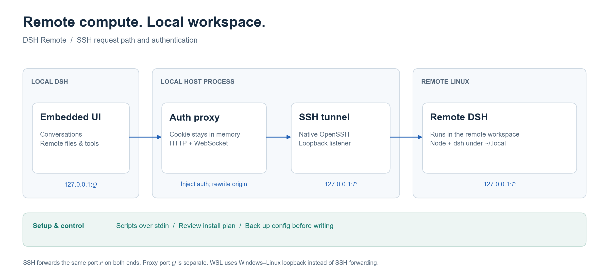

# Technical reference

[中文](architecture.md) · [Back to README](../README.en.md)

## Connection path



The host process owns targets, remote processes, connections and authentication. The embedded page talks to a local proxy, which forwards HTTP requests and WebSocket connections to the target DSH instance.

| Port | Purpose |
|---|---|
| `P` | Remote DSH listener and the local end of the SSH tunnel |
| `Q` | Local authentication proxy used by the iframe and Open in browser |

A DSH authentication cookie is bound to `host:port`, so both SSH tunnel endpoints use the same `P`:

```text
ssh -N -L 127.0.0.1:P:127.0.0.1:P <host>
```

The manager checks candidate ports on both machines before launching. The proxy separately binds `127.0.0.1:Q`; `Q` need not equal `P`.

WSL uses the same proxy without an SSH tunnel. Windows–WSL loopback connectivity carries requests to port `P` inside the distribution.

## Scripts and SSH

Remote scripts travel on standard input so Windows command-line parsing cannot alter their quotes or `$(...)` expressions:

```text
ssh <host> bash
wsl.exe -d <distribution> -- bash
```

Each script first loads an available nvm configuration, then prepends `~/.local/bin` and `~/.local/node/bin` to PATH. Probes and subsequent operations use the same user-local toolchain.

SSH uses the local OpenSSH client. An alias is passed directly to `ssh`, preserving keys, ssh-agent, ProxyJump and ProxyCommand; a manually entered target supplies its user, port and identity-file arguments.

- `BatchMode=yes` disables interactive password prompts. Targets need key or agent authentication.
- `StrictHostKeyChecking=accept-new` accepts a new host key and rejects a key that differs from an existing record.
- After a successful connection, fingerprint lookup from local `known_hosts` is best effort. There is no pre-connection fingerprint approval dialog, and a fingerprint may be unavailable for some targets.

## Embedded authentication and request fences

The desktop page has a custom `app` origin, making an HTTP iframe cross-site. The browser cannot send the remote DSH instance's `SameSite=Strict` cookie directly in that iframe.

The host proxy handles authentication:

1. The host performs `/?token=…` through the forwarded port and receives the remote cookie.
2. The proxy holds that cookie in host memory and injects it into upstream requests.
3. The iframe receives `http://127.0.0.1:Q/` without a token in its URL. Remote `Set-Cookie` headers are withheld from browser responses.
4. If an upstream HTTP response is 401, the proxy repeats the handshake and retries once.

The remote API also checks request origins. The proxy rewrites `Host`, an existing `Origin`, and a valid `Referer` to the remote authority, and sets `Sec-Fetch-Site` to `same-origin`. WebSocket upgrades use the same header handling before forwarding bytes in both directions.

The host's `/api/dsh-remote/*` control routes have a separate local fence: they check the loopback socket, Host and browser-origin markers, and reject proxy requests carrying `X-Forwarded-For` or `CF-Connecting-IP`.

### Startup checks

The manager first checks the forwarded remote page and authentication, then starts the proxy. **The state becomes `running` only after an anonymous GET `/` through the proxy returns 200.** WebSocket upgrade checks belong to the separate embed-auth test, not this startup health check.

See [manager.js](../lib/manager.js), [frame-proxy.js](../lib/frame-proxy.js) and [loopback.js](../lib/loopback.js).

## Remote processes and recovery

The remote instance runs `dsh web --no-open --port P` with a public authority matching the forwarded port. It uses a dedicated tmux session when available, otherwise setsid, with nohup as the fallback when setsid is absent.

The fallback runner writes its own `$$` to a PID file before `exec`ing dsh, keeping the recorded PID attached to the service. Before a fresh launch, the manager reads the previous port from that target's old log and reaps the previous instance.

Reconnection first checks whether the old instance still listens on its recorded port. A reusable instance needs only a new local connection. An unavailable instance, mismatched authority or occupied local SSH port leads to a fresh launch.

| Action or condition | Behavior |
|---|---|
| Close the panel | Keep the remote process; stop panel status polling |
| Exit local DSH | Release local tunnels and proxies; keep the remote process |
| No status access for 30 minutes | Release the local connection; leave the target available for reconnection |
| SSH tunnel exits | Retry at intervals of 1, 2, 4, 8, 16 and 30 seconds, at most six attempts |
| Stop remote | Attempt to terminate the target instance; close its local tunnel and proxy |
| Restart | Stop, then connect and launch again |

Idle cleanup runs once a minute; status requests refresh the access time. Discovery is cached for one minute and environment probes for ten minutes. Startup and installation planning probe the environment again.

## Configuration porting

Local configuration comes from the current profile's `cordis.patch.yml` and DSH's `.credentials.yaml`. The profile follows `DSH_PROFILE`, falling back to `desktop`. The destination is the remote `web` profile.

Selection is by group:

| Group | What is written | Default selection |
|---|---|---|
| Model providers | Replace the remote `llm-pi-ai` block with the local block, including providers, endpoints and model lists | On when present locally |
| Default model | Replace the remote `agent-default-model` block | On when present locally |
| API keys | Merge all local `refs` into the remote credential file, including actual key values | On when present locally |
| DeepSeek account credentials | Write filtered local `records` account data | Off |

Previews show names, key names and counts, with secret values hidden. Selecting API keys transfers their values to the chosen target. Account credentials also contain login tokens; port them only to trusted targets.

API-key porting handles only `refs`. Account porting excludes `client-connection/browser-session` and its entire payload while retaining other local account records. Filtering runs both during preview and before writing. When only a browser session remains, the account group is unavailable and remote `records` are left untouched.

The filter supports DSH's block mappings with plain, single-quoted and JSON-compatible double-quoted keys. Unrecognized keys, flow record mappings, YAML aliases, anchors or tags cause the account group to be skipped; API keys remain independently portable.

Existing files are backed up to `*.bak-<timestamp>` before writing. Writes use `umask 077` and set file permissions to 0600. The patch editor handles a fresh profile's `[]` placeholder and preserves unrelated blocks.

A running instance can load the changes with Write and restart; an offline target loads them on its next connection. See [config-sync.js](../lib/config-sync.js) and [yaml-blocks.js](../lib/yaml-blocks.js).

## Data locations

| Location | Content |
|---|---|
| Local `~/.dsh/dsh-remote.json` | Saved targets, excluding runtime tokens, ports and tunnels |
| Remote `~/.local/node-<version>` and `~/.local/node` | User-local Node installation and entry point |
| Remote `~/.local/bin/dsh` | User-local dsh executable entry point |
| Remote `~/.dsh-remote/<id>.log` | Per-target DSH startup and runtime output |
| Remote `~/.dsh-remote/dsh-remote-<id>.pid` and `*.run.sh` | Fallback runner PID and launch script |
| Remote `~/.dsh/profiles/web/cordis.patch.yml` | Ported provider and default-model configuration |
| Remote `~/.dsh/.credentials.yaml` | Ported API keys and optional account records |

`DSH_HOME` can override the local data root. Registry writes are atomic and request mode 0600; Windows applies its filesystem permission model. Remote DSH logs may contain authenticated access links; remove their tokens before sharing logs.

## Troubleshooting

| Symptom | Check |
|---|---|
| SSH authentication fails | Confirm `ssh <host>` works with keys or ssh-agent in a local terminal |
| Host key changes | Verify the new fingerprint with the administrator before using `ssh-keygen -R <host>` and retrying |
| SSH tunnel is not ready | Check that the server permits TCP forwarding and that the target can start DSH |
| WSL port is unreachable | Check mirrored networking or NAT with `localhostForwarding=true`; save WSL work before applying network changes and restarting the distribution |
| Blank interface or authentication error | Reload the page; restart local DSH after host-plugin updates, then inspect the target log |
| Model calls fail | Check remote provider configuration and keys; restart the remote instance after porting changes |
| Installation action is missing | Run Probe first; an environment with Node and dsh already installed needs no installation |

Source entry points: [channel.js](../lib/channel.js) · [probe.js](../lib/probe.js) · [bootstrap.js](../lib/bootstrap.js) · [paths.js](../lib/paths.js)
