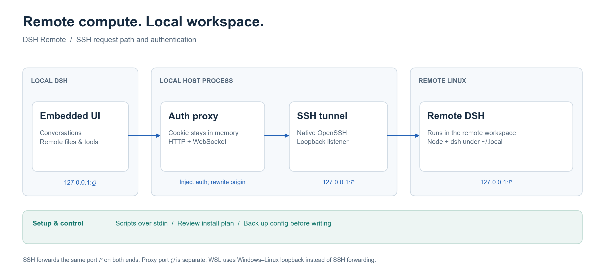

# 技术参考

[English](architecture.en.md) · [返回 README](../README.md)

## 连接链路



宿主进程管理目标、远程进程、连接和认证。浏览器中的远程页面访问本机代理，代理再把 HTTP 请求与 WebSocket 连接转发到目标 DSH。

| 端口 | 用途 |
|---|---|
| `P` | 远程 DSH 监听端口，也是 SSH 隧道的本地端口 |
| `Q` | 本机认证代理端口，供 iframe 和「在浏览器打开」使用 |

DSH 认证 cookie 绑定 `host:port`，因此 SSH 转发两端使用相同的 `P`：

```text
ssh -N -L 127.0.0.1:P:127.0.0.1:P <host>
```

启动前，管理器检查本机和目标上的候选端口是否可用。代理另行监听 `127.0.0.1:Q`；`Q` 不需要等于 `P`。

WSL 目标使用相同的代理，但不建立 SSH 隧道。本机通过 Windows–WSL 回环连接访问发行版中的端口 `P`。

## 脚本与 SSH

远程脚本经标准输入发送，避免 Windows 命令行重新解析脚本中的引号和 `$(...)`：

```text
ssh <host> bash
wsl.exe -d <distribution> -- bash
```

每段脚本先加载可用的 nvm 配置，再把 `~/.local/bin` 与 `~/.local/node/bin` 放到 PATH 前面。探测与后续操作使用同一套用户目录工具链。

SSH 使用本机 OpenSSH。配置别名直接交给 `ssh` 解析，因此密钥、agent、ProxyJump 和 ProxyCommand 继续生效；手动目标传递其用户、端口与私钥参数。

- `BatchMode=yes` 禁止交互式密码提示，目标需要密钥或 agent 登录。
- `StrictHostKeyChecking=accept-new` 自动接受首次连接的主机密钥，拒绝已经记录但发生变化的密钥。
- 指纹在连接成功后从本机 `known_hosts` 尽力读取，供比对使用；面板没有连接前的指纹确认对话框，部分目标可能无法显示指纹。

## 内嵌认证与请求围栏

桌面页面使用自定义 `app` origin，HTTP iframe 属于跨站内容。远程 DSH 的 `SameSite=Strict` cookie 无法依靠浏览器直接发送给这个 iframe。

认证由宿主代理完成：

1. 宿主经转发端口执行 `/?token=…` 握手，接收远程 DSH 的 cookie。
2. 代理在宿主内存中保存 cookie，并为上游请求补充 `Cookie`。
3. iframe 获得 `http://127.0.0.1:Q/`，地址不包含 token；远程 `Set-Cookie` 不转发到浏览器。
4. HTTP 上游返回 401 时，代理重新握手并重试一次。

远程 API 围栏还会检查请求来源。代理把 `Host`、已有的 `Origin` 和有效的 `Referer` 改写为远程 authority，并将 `Sec-Fetch-Site` 设为 `same-origin`。WebSocket 升级使用相同的头部处理，然后双向转发连接字节。

宿主的 `/api/dsh-remote/*` 控制路由另有本机围栏：检查回环 socket、Host 与浏览器来源标记，拒绝 `X-Forwarded-For` 或 `CF-Connecting-IP` 标记的代理请求。

### 启动检查

管理器先检查转发后的远程首页与认证，再启动本地代理。**经代理匿名 GET `/` 返回 200 后，状态才进入 `running`。** WebSocket 升级检查由独立的内嵌认证测试完成，不属于这项启动健康检查。

实现见 [manager.js](../lib/manager.js)、[frame-proxy.js](../lib/frame-proxy.js) 和 [loopback.js](../lib/loopback.js)。

## 远程进程与恢复

远程实例执行 `dsh web --no-open --port P`，并设置与转发端口一致的公开 authority。有 tmux 时使用独立 session；否则使用 setsid，缺少 setsid 时退回 nohup。

fallback runner 先把自己的 `$$` 写入 PID 文件，再 `exec` dsh，使 PID 指向实际服务进程。每次重新 launch 前，管理器从该目标的旧日志读取端口并回收上一实例。

重新连接优先检查旧实例是否仍监听其记录的端口。能够复用时只重建本地连接；实例不可用、authority 不一致或 SSH 本地端口冲突时，启动新实例。

| 操作或条件 | 行为 |
|---|---|
| 关闭面板 | 保留远程进程；停止面板的状态轮询 |
| 本地 DSH 退出 | 释放本地隧道与代理，保留远程进程 |
| 30 分钟没有状态访问 | 释放本地连接，目标回到可重新连接的状态 |
| SSH 隧道退出 | 按 1、2、4、8、16、30 秒间隔最多重试六次 |
| 停止远程 | 尝试终止该目标实例，关闭本地隧道和代理 |
| 重启 | 停止后重新连接并启动实例 |

空闲检查每分钟运行一次，状态请求会刷新访问时间。目标发现缓存为 1 分钟，环境探测缓存为 10 分钟；启动和安装计划会重新探测环境。

## 配置移植

本地配置来源为当前 profile 的 `cordis.patch.yml` 与 DSH 的 `.credentials.yaml`。profile 使用 `DSH_PROFILE`，未设置时为 `desktop`。写入目标固定为远程 `web` profile。

选择以整组为单位：

| 组 | 写入内容 | 默认选择 |
|---|---|---|
| 模型服务商 | 用本地 `llm-pi-ai` 块替换对应远程块，包含服务商、地址和模型列表 | 有本地配置时开启 |
| 默认模型 | 替换远程 `agent-default-model` 块 | 有本地配置时开启 |
| API 密钥 | 将全部本地 `refs` 合并到远程凭据文件，包含实际密钥值 | 有本地配置时开启 |
| DeepSeek 账号凭据 | 写入本地 `records` 账号记录 | 关闭 |

预览只显示名称、键名和数量，隐藏密钥值。勾选 API 密钥会把密钥值传给所选目标；账号凭据也包含登录令牌，应只移植到可信目标。

API 密钥移植只处理 `refs`。账号凭据选项会复制整个 `records` 块；若其中包含本机浏览器会话，不要勾选该项。

写入前，已有文件备份为 `*.bak-<时间戳>`；写入使用 `umask 077` 并设置文件权限为 0600。patch 编辑器处理新 profile 的 `[]` 占位符，保留无关配置块。

正在运行的实例可通过「写入并重启」加载新配置；未运行的目标在下一次连接时加载。实现见 [config-sync.js](../lib/config-sync.js) 和 [yaml-blocks.js](../lib/yaml-blocks.js)。

## 数据位置

| 位置 | 内容 |
|---|---|
| 本机 `~/.dsh/dsh-remote.json` | 保存的目标；不保存运行态 token、端口或隧道 |
| 远程 `~/.local/node-<version>`、`~/.local/node` | 用户目录 Node 安装及入口 |
| 远程 `~/.local/bin/dsh` | 用户目录 dsh 可执行入口 |
| 远程 `~/.dsh-remote/<id>.log` | 每个目标的 DSH 启动与运行输出 |
| 远程 `~/.dsh-remote/dsh-remote-<id>.pid`、`*.run.sh` | fallback runner 的 PID 与启动脚本 |
| 远程 `~/.dsh/profiles/web/cordis.patch.yml` | 移植的服务商与默认模型配置 |
| 远程 `~/.dsh/.credentials.yaml` | 移植的 API 密钥与可选账号记录 |

本机数据根目录可由 `DSH_HOME` 改写。目标注册表请求以 0600 权限原子写入；Windows 上仍使用其文件系统权限机制。远程 DSH 日志可能含认证访问链接，分享日志前应去掉 token。

## 排错

| 现象 | 检查方式 |
|---|---|
| SSH 认证失败 | 在本机终端确认 `ssh <host>` 能通过密钥或 agent 登录 |
| 主机密钥变化 | 先向管理员核实新指纹，再用 `ssh-keygen -R <host>` 移除旧记录并重试 |
| SSH 隧道未就绪 | 检查服务端是否允许 TCP 转发，以及目标能否启动 DSH |
| WSL 端口不可达 | 检查 mirrored 网络，或 NAT 的 `localhostForwarding=true`；保存 WSL 中的工作后再应用网络配置并重启发行版 |
| 界面空白或认证错误 | 重载页面；插件宿主代码更新后重启本地 DSH，再检查目标日志 |
| 模型调用失败 | 检查远程服务商与密钥是否齐全；移植配置后重启远程实例 |
| 没有安装入口 | 先运行「探测环境」；环境已有 Node 和 dsh 时无需安装 |

源文件入口：[channel.js](../lib/channel.js) · [probe.js](../lib/probe.js) · [bootstrap.js](../lib/bootstrap.js) · [paths.js](../lib/paths.js)
